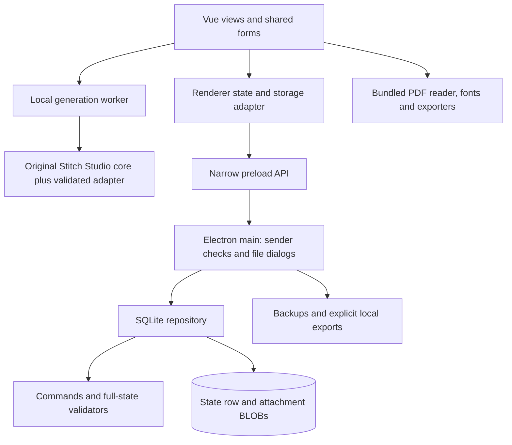

# Architecture and operational boundaries

Source-oriented description for Ricamo 0.2.0, reviewed on 2026-10-27. This describes the implementation, not certification of every packaged artifact. [STATUS.md](STATUS.md) records runtime evidence and [REQUIREMENTS.md](REQUIREMENTS.md) maps the master prompt. See [DATA-FORMATS.md](DATA-FORMATS.md) for schemas and file envelopes, and [ENGINE-AUDIT.md](ENGINE-AUDIT.md) for the inherited generator.

## Runtime and module boundaries

Ricamo is an offline desktop application. Electron 45.0.0 packages Chromium and Node; Vue 3.5.44 renders the interface. Vite 8.3.5 builds local assets, electron-builder 26.18.0 produces the Windows x64 NSIS package. Versions are pinned in package.json/package-lock.json; Node 24+ is the development/test target. The installed app does not need a separate development server, Node installation or the original Stitch Studio directory.

- `src/views` orchestrates user flows. `src/components` supplies the shared form/dialog system and bounded domain panels. `src/state.js` coordinates state replacement after acknowledged commands; `src/storage.js` separates native persistence from the browser preview.
- `core/commands.mjs`, `core/application.mjs` and domain modules implement commands over plain, serializable state. Geometry in `core/pattern.mjs` is independent of Vue and the TypeScript quantizer. Domain validators also run during native startup and restore.
- `desktop/repository.mjs` is the authoritative native persistence boundary. Main-process services own dialogs, backup paths, imports and project transfer capabilities. The renderer does not receive unrestricted filesystem access.
- Browser development uses IndexedDB. It is useful for UI tests but is not evidence for native SQLite, installation or native dialogs. The example studio is intentionally separate: a dedicated window/session and IndexedDB library, without the normal Repository bridge.
- CPU image conversion runs in a module worker. Local PDF.js 6.4.299 renders references; jsPDF 4.2.1 exports documents with bundled DejaVu fonts. Lucide supplies the UI icon family. Their notices are retained in [THIRD-PARTY-NOTICES.md](../THIRD-PARTY-NOTICES.md).

## Command and persistence contract

A command has a type, payload and operation ID. Execution verifies that the handler is an own supported entry, detects retries using the recorded signature, clones state, applies the domain change, validates the resulting state and increments the application revision. A repeated operation with the same payload does not repeat physical effects; reusing its ID with changed content is rejected. IDs for retryable UI actions must stay stable until that attempt succeeds or is abandoned.

The native Repository uses SQLite `BEGIN IMMEDIATE` transactions. An unseen operation requires the renderer's expected revision to match current state. State and any newly managed attachments commit together for atomic pattern creation, project transfer and material/project/session saves with optional initial lots. Exceptions roll back. The database uses WAL, synchronous FULL and a busy timeout. It contains one JSON application-state row and an attachment BLOB table; it is not a table-per-domain relational model or a complete event-sourced replay engine.

This representation keeps validation and portable snapshots simple, at the cost of loading, validating and serializing the state on writes. Large libraries therefore have an O(library-size) persistence cost. Changing that tradeoff requires measured, comparable workloads, not only a UI benchmark. The recorded WSL/NTFS and Linux-filesystem timings differ substantially; do not label one a native Windows regression without a native measurement.

Startup first probes an existing database read-only, validates its schema/state revision and refuses newer unsupported schemas before journal/schema writes. SQLite schema version 1 and application version 0.2.0 are different contracts. Feature blocks also have typed/versioned validation. No downgrade conversion is silently attempted.

## Domain invariants

| Boundary | Invariant |
| --- | --- |
| Catalogue / lot | Identity and product properties are separate from physical quantity, location, dye lot and condition. |
| Reservation / consumption | A reservation reduces free availability, not physical stock. Confirmed consumption changes physical stock and its related reservation without subtracting twice. |
| Unknown / zero | Null means unestablished quantity or conversion. Zero is a known value. An estimate keeps its confidence; arithmetic does not make it exact. |
| Shared requirements | Aggregate purchasing allocates shared usable stock once. Unmeasured holdings can leave a gap uncertain; automatic orders skip an unknown quantity. |
| Fabric | Reservations and cuts are geometric. Overlapping reservations are rejected; confirmed cuts retain origin, dimensions, remnants and conserved costs. |
| Kits | A virtual list affects planning only. Verified physical opening removes an intact unit and adds only checked components; later verification does not reopen the kit. Common cost stays distinct from component consumption. |
| Revisions / work | Saved structured revisions are immutable. A project pins pattern and revision; completed full/half/back primitives are separate. Marking progress does not consume stock. |
| Notes / markers | Reference annotations and continuation/parked-thread markers are not point completion. Scoped coordinates are never silently applied to another revision. |
| Estimates / forecasts | Component conversions, fabric density, calibration and source revision are explicit. Missing inputs remain unknown; manual assumptions are distinguished from measured sessions. |
| Closure | Project closure releases reservations/assignments without fabricating consumption. Completed history survives reopening. |

Quantities use bounded decimal normalization to six places with integer-scaled addition/subtraction; persisted JSON quantities remain numbers. Monetary costs use integer minor units. Separate currencies are not silently converted. Thread blends expand into actual catalogue component needs with whole strand counts; a visual blended palette entry does not constitute owned physical stock.

Estimate-history snapshots have their own validation and capacity (1000 snapshots / 32 MiB); ordinary project settings retain their separate 100 KB limit. Capacity failures preserve the prior history rather than silently dropping the oldest receipt. Historical estimate-management UI is not implemented.

## Editing, acknowledgement and recovery

A published revision, an editor draft and project progress have separate lifecycles. Draft writes use generation-based acknowledgement with at most one write in flight. A newer edit cannot be called saved merely because an older write completed. Close/navigation handlers flush pending writes or present retry/stay/explicit-discard choices. Native close IPC lets main defer window destruction until the renderer completes this decision. Abrupt loss before acknowledgement can still lose the last uncommitted edit.

Structured work context is scoped to pattern/revision. Viewport updates cannot overwrite marker changes. Old unassigned bookmarks require explicit association; historical markers remain readable/removable without applying their coordinates. Tab changes in the embedded project editor use the same flush behavior as route changes. Geometry-based totals exclude empty cells, and marking filters never change the denominator.

Project packages explicitly select revisions, attachments, privacy fields and catalogue decisions. They do not import physical stock or reservations. Optional work markers require their referenced immutable revisions or explicit omission. New-work copies clear progress-related state. The package service and final domain validation remain the authority for remapped identities; renderer previews cannot authorize arbitrary import commands.

## Files, backup and trust boundaries

Imported images/PDFs are bounded, type-detected and stored as managed bytes, separate from their display names. Image container/dimension preflight runs before decoding. File signatures and dimension checks do not prove that every compressed payload is well formed; decoders and validation errors remain part of the boundary.

A complete backup reads state and immutable BLOBs within one SQLite read transaction. It does not copy a live database file while ignoring WAL. The resulting versioned envelope is inspected for domain shape, referenced assets and digests before restore. Restore is revision-checked and transactional; main preserves a pre-restore backup before replacing the library. Exports use a flushed temporary sibling and rename; a cancelled native destination produces no successful-save acknowledgement. See DATA-FORMATS for exact byte limits and formats.

The production renderer is sandboxed with context isolation, Node integration disabled, web security enabled and no webview tag. IPC accepts only the intended window's main frame. The `ricamo://app` protocol resolves within the bundled public asset root, restricts types/methods and rejects path escape. Navigation/new windows and permissions are denied. Production requests allow local application/data/blob resources, not HTTP services. PDF.js assets, codecs and fonts are local. These are implemented controls, not a claim of universal security or an operating-system firewall test.

Backups and project files are not encrypted. Operating-system account/disk protections remain relevant. The app neither requires a cloud account nor provides cloud synchronisation, real-time collaboration or fiscal invoicing.

## Build, verification and rollback

Use the committed lockfile, `npm ci`, `npm test` and `npm run build`. Native journeys use `npm run test:desktop`; scoped runners support isolated data roots and a chosen packaged executable. `npm run package:win` builds an unsigned NSIS installer. Keep source revision, dist build, executable and test data identity together: a pass against an older executable does not validate later source edits.

Release verification should include startup, real generation, saving/reopening SQLite, PDF export, backup/restore and cancellation in the exact installed candidate. Installer metadata is not a publisher signature. Test data belongs in isolated runtime folders, not the personal library.

For an update, retain the previous installer and a verified full backup from the previous usable version. For rollback, close the app, preserve the current data separately, install a known compatible version and restore a backup that version can validate. Do not overwrite a running SQLite file or delete WAL as a recovery shortcut. A newer schema must remain untouched when the old application refuses it. Source rollback uses reviewed reverting changes; it does not itself reverse user data.

Development evidence includes an actual Windows 10 Home x64 build 19045 installation and selected native packaged journeys. Clean Windows 11, an independent accented Windows account, every printer, signed distribution and every latest-feature journey are separate outstanding or build-specific claims. Consult STATUS and the requirements ledger rather than inferring them from Linux Electron, browser tests or a successful build.
